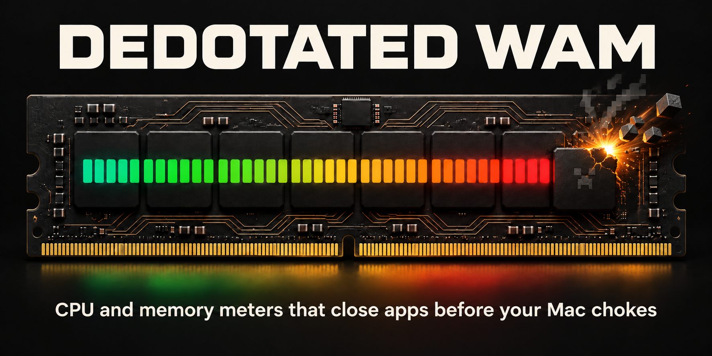

# Dedotated Wam

A macOS menu bar app that shows CPU and memory use as small live meters and, when memory runs out, closes apps for you in an order you choose, so the Mac never gets to the point where it is too choked to close anything by hand.

**[Download it and see how it works](https://therealeminem.github.io/dedotated-wam/)**

## What it does

- **Menu bar meters.** CPU as a row of bars (recent history, or one bar per core) and memory as a capsule that fills up, shaded by app, wired and compressed memory. The memory meter turns orange, then red, as memory gets tight. On a laptop a battery meter sits beside them (with a bolt while plugged in, orange or red when running low), so the system's own battery icon can be switched off. Three layouts: graphs with numbers, graphs only, compact stacked bars.
- **Popover.** Click the meters for the memory breakdown, swap, per-core CPU, and the biggest apps with their helper processes counted in (a browser is charged for its tabs). Hover an app to quit or force quit it. Protected apps (your "never close" groups and system pieces such as Finder) show a lock and ask you to confirm first.
- **Auto-close.** Off by default. In *Warn only* it tells you what it would close. In *Auto-close* it works through your groups until memory recovers:
  - **Stage 1** (memory tight): asks apps to quit nicely, one at a time, with a pause between each.
  - **Stage 2** (memory critical): apps in a "force if stuck" group that ignored the polite request are force quit.
- **Priorities.** Apps are sorted into ordered groups. Each group sets how its apps are closed (nicely only, nicely then force, force at once, never) and in what order (list order or biggest first). On first launch the installed apps are sorted into four suggested groups from a built-in catalog: *Close first*, *Close next*, *Last resort*, *Never close*.
- **Background processes.** The popover can switch from apps to single processes, so you can see and end the one process inside an app that is actually using the memory. A group can also hold a process by name (a model runner, a stray `node`), and auto-close will end just that process when its group's turn comes. Processes that belong to macOS are protected.
- **Safety.** The app you are using is never closed, small apps are skipped, system apps are protected, and everything it does is written to an activity log.

## Install

1. Download [DedotatedWam.dmg](https://github.com/TheRealEminem/dedotated-wam/releases/latest/download/DedotatedWam.dmg), the latest release. It runs on Apple silicon and Intel Macs with macOS 14 or later.
2. Open it and drag **Dedotated Wam** onto **Applications**, then open it from Applications.
3. **First open only.** The app is signed without an Apple Developer ID, so macOS says it cannot verify it and offers only **Done** or **Move to Trash**. Click **Done**, then do one of these:
   - open **System Settings, Privacy & Security**, scroll down to *"Dedotated Wam" was blocked*, and press **Open Anyway** (then your Mac password, and **Open Anyway** once more), or
   - in Terminal: `xattr -dr com.apple.quarantine "/Applications/Dedotated Wam.app"`.
4. The meters appear in the menu bar. There is no Dock icon and no window: click the meters for the details, and **Settings…** there for everything else.

Auto-close is off until you turn it on in **Settings, Auto-close**. Try *Warn only* first: it tells you what it would have closed and touches nothing.

To update, replace the app with the newer one. To remove it, delete the app and, if you want your settings gone too, `~/Library/Application Support/DedotatedWam`.

It is built and used daily on an Apple silicon Mac with macOS 27. The Intel half of the app and older macOS versions are built but have had much less use, so reports from those are welcome.

If the meters do not appear, a menu bar manager may have filed the new item in its hidden section. Expand it and drag the item out while holding Command. Until then, opening the app again (Finder, Spotlight) brings up its Settings window.

## Build it yourself

Needs macOS 14 or later and the Xcode Command Line Tools (`xcode-select --install`). Full Xcode is not required. A copy you build yourself opens without the first-open step above.

```bash
Scripts/build-app.sh --run
```

To install it in `/Applications` (needed for *Open at login*):

```bash
Scripts/build-app.sh --install
```

Run the tests:

```bash
Scripts/test.sh
```

Pack a disk image for both Apple silicon and Intel, with its checksum, into `dist/`:

```bash
Scripts/build-app.sh --dmg
```

## Where things live

| Path | What |
|---|---|
| `Sources/WamCore` | Sampling, settings, the app catalog and the triage logic. No UI. |
| `Sources/DedotatedWam` | The menu bar app: meters, popover, settings window, closing apps. |
| `Tests/WamCoreTests` | Tests for the triage rules, the process roll-up and the catalog. |
| `Scripts/build-app.sh` | Builds and signs `build/Dedotated Wam.app`, and packs the disk image. |
| `Scripts/drill.sh` | Live check that auto-close closes what it should and nothing else. |
| `docs/` | The download page, served by GitHub Pages. |
| `~/Library/Application Support/DedotatedWam` | Your settings and the activity log. Not in the repo. |

## Developer aids

```bash
"build/Dedotated Wam.app/Contents/MacOS/DedotatedWam" --print-snapshot
```

prints one reading of memory, the biggest apps and the current closing order.

```bash
"build/Dedotated Wam.app/Contents/MacOS/DedotatedWam" --render-previews /tmp/wam-previews
```

draws the meters, popover and settings with made-up numbers into PNG files, for checking layout without touching real settings.

```bash
Scripts/drill.sh
```

is the live check of auto-close, worth running before a release. It builds three throwaway apps, opens them in the background, and runs the app's real monitor and closing code as if memory were critical, allowed to close only those targets. One app should quit when asked, a background process should be ended, an app that refuses to quit should be force quit, and an app that is in no rule should be left alone. Your own settings and activity log are not touched.

## Support

Dedotated Wam is free. A Buy Me a Coffee link is coming soon.

## License

[AGPL-3.0](LICENSE).
